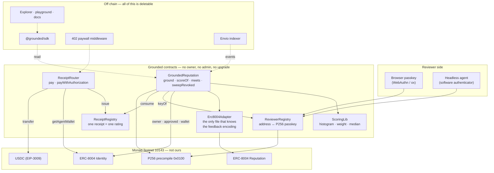
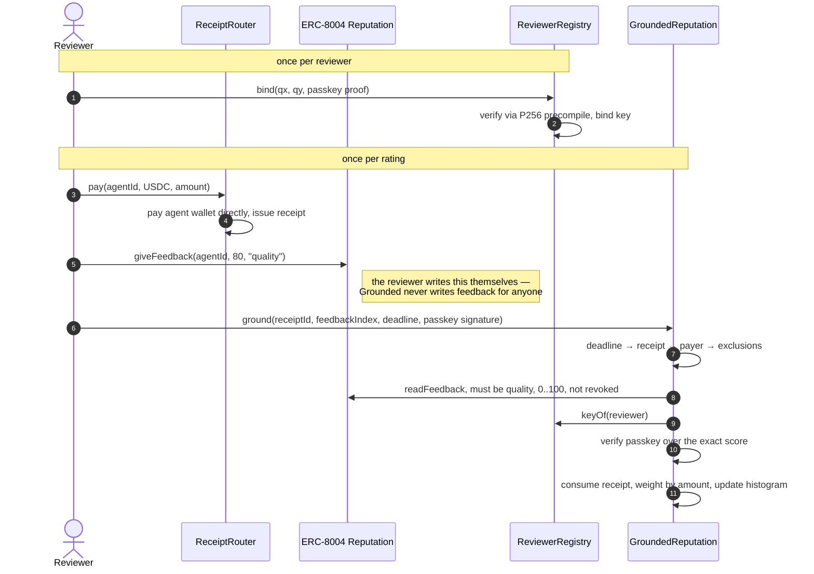
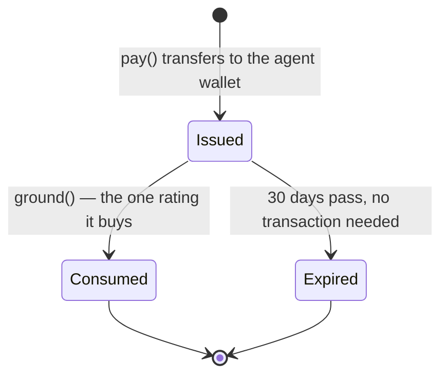

# Grounded

Payment-grounded reputation for [ERC-8004](https://eips.ethereum.org/EIPS/eip-8004) agents on Monad Testnet (10143).

A rating counts only if the reviewer **paid the agent on chain** (one receipt, one rating), **signed it with a passkey** bound to their address, and used a fixed scale and tag. The score is a public contract view anyone can recompute — **payment-grounded, not self-attested**.

> Status: in development for Monad Metropolis. Contracts are unaudited and testnet-only.

## Why it exists

Agent reputation today is self-attested: anyone can write feedback about anyone, so the cheapest attack is also the most effective one — spin up wallets, spray five-star reviews, sell a worthless agent. ERC-8004 gives agents a shared place to *store* feedback, but it does not say which feedback deserves belief.

Grounded adds the missing precondition. A rating is counted only when the chain can prove the rater was a customer. Everything below follows from that one rule.

## Architecture



The boundary matters: **delete every box in "Off chain" and the score is unchanged.** Nothing off chain sits between a payment and a rating. The SDK and explorer are convenience, not authority.

We also do not trust the ERC-8004 registries blindly — they are upgradeable and owned by their deployer, so every read of them is isolated behind `Erc8004Adapter`, and a rating's value is re-checked on chain rather than taken on faith.

## How a rating is made



Every check has its own error and its own test. The order is cheapest-first, so a doomed call fails before it spends money on registry reads.

**If the reviewer later revokes their ERC-8004 feedback**, the rating must stop counting. Anyone may call `sweepRevoked(agentId, reviewer)`, which re-reads the registry and removes the rating if, and only if, it really was revoked. No admin, no trust, no schedule required.

## What makes a score hard to game

| Attack | What stops it |
|---|---|
| Sybil five-star spam | Each rating needs a real payment to the agent's own wallet |
| Buying a score cheaply | Weight is `log2` of the amount paid, capped at 4 — 1000× the money is 4× the vote |
| One reviewer, many ratings | One live rating per reviewer per agent; a new one replaces the old |
| Agent rating itself | Owner, approved operator, operator-for-all and agent wallet are all excluded |
| Outliers dragging the score | The score is a weighted **median**, not a mean |
| Rate, then revoke the evidence | `sweepRevoked` removes it permissionlessly |
| Reusing one payment | The receipt is consumed on the first rating, and expires after 30 days |
| Score inherited after a sale | `ownerChangedAt` is recorded, so consumers can discount ratings from before the sale |

Honest limits:

- A passkey is **not** proof of personhood. The contract cannot tell a hardware key from a software one, and it is not meant to. Sybil resistance comes from the payments, not the keys.
- **An agent's owner can still rate itself through wallets it controls.** The exclusions only catch addresses linked to the agent on chain. And because the payment lands in the agent's *own* wallet, the owner gets the money back — the real cost of self-rating is gas, not the amount paid. Payment-grounding stops strangers from spraying reviews at an agent; it does not stop an agent from reviewing itself through fresh wallets. The explorer is meant to surface reviewer patterns so this stays visible rather than hidden.

## Repo

| Path | What |
|---|---|
| `contracts/src/` | `ReceiptRegistry`, `ReceiptRouter`, `ReviewerRegistry`, `GroundedReputation`, `lib/ScoringLib`, `lib/GroundedWebAuthn`, `adapters/Erc8004Adapter` |
| `contracts/test/` | `unit/`, `fork/` (live testnet, opt-in), `invariant/` |
| `contracts/abi/erc8004/` | ABIs of the deployed ERC-8004 registries, selector-verified against testnet bytecode |
| `packages/sdk/` | `@grounded/sdk`: score/check, pay/rate, `withTrust`, and `groundedPaywall` (`/server`) |
| `apps/demo-seller/` | Hono agent service charging per request through the 402 paywall |
| `apps/demo-buyer/` | Script agent that pays a 402 seller only if its agent passes a trust policy |
| `grounded-docs/` | PRD, TRD, system architecture, timeline, deployment, integrations |
| `docs/BUILDLOG.md`, `docs/TASKS.md` | Daily log, and what is left |

## Develop

```bash
cd contracts
forge build
forge test                                    # unit + fuzz + invariant
MONAD_FORK_RPC=https://testnet-rpc.monad.xyz \
  forge test -n monad --match-path "test/fork/*"   # live testnet; -n monad is required
```

`-n monad` selects Foundry's Monad network family — forks fail without it.

### Run the stack locally

There is no offchain facilitator: `ReceiptRouter` settles every payment onchain. Locally that means an anvil fork of Monad testnet with our four contracts on it, and a seller behind the 402 paywall.

```bash
# 1. chain: fork testnet (live ERC-8004 + USDC underneath), deploy Grounded to it
anvil --fork-url https://testnet-rpc.monad.xyz --host 0.0.0.0
cd contracts && RP_ID=localhost forge script script/Deploy.s.sol --rpc-url http://127.0.0.1:8545 \
  --private-key <anvil key 0> --broadcast --skip-simulation     # writes deployments/10143.json

# 2. backend: demo seller, paid as agent 1 (has a payout wallet)
pnpm --filter @grounded/sdk build
SELLER_AGENT_ID=1 NEXT_PUBLIC_RPC_URL=http://127.0.0.1:8545 pnpm --filter @grounded/demo-seller start   # :8787

# 3. buyer: pays only if agent 1 passes the policy (default: score >= 70 from >= 1 reviewer)
BUYER_PRIVATE_KEY=<funded key> NEXT_PUBLIC_RPC_URL=http://127.0.0.1:8545 pnpm --filter @grounded/demo-buyer start -- \
  --target http://localhost:8787/insight --min-score 0 --min-reviewers 0
```

`GET /insight` answers 402 until a buyer pays through the router; the buyer's `withTrust(fetch, policy)` does that automatically. An agent that fails the policy is paid nothing and the buyer exits 2 with the reasons.

## Verified on chain, not assumed

Every load-bearing claim below was checked against Monad testnet rather than taken from documentation.

| Fact | How it was checked |
|---|---|
| P256 precompile `0x0100` (EIP-7951) verifies real signatures | Called with a genuine signature; a software passkey binds through it in a fork test |
| ERC-8004 Identity `0x8004…BD9e` and Reputation `0x8004…8713` are live (UUPS proxies) | Selector check against deployed bytecode, plus live calls |
| USDC `0x534b…43A3` supports EIP-3009, 6 decimals, EIP-712 domain `"USDC"` v2 | Read from the token; a fork test pays an agent with a signed authorization |
| ERC-8004 feedback indices are **1-based** | Written and read back through the live registry (23 Sep) |
| `MCOPY`/`TSTORE` execute on 10143 | Probed with `cast call --override-code`, which is why `evm_version = "cancun"` |

Measured gas (fork, live precompile): `pay` 155k · `bind` 158k · `ground` 353k · `sweepRevoked` 108k. About a third of `ground` is exclusion and feedback reads into the ERC-8004 proxies.

## Receipt lifecycle



Expiry is evaluated on read, so nobody has to run a job to age receipts out, and no one can be paid to do it.

## Keys we hold and why

Nothing in the protocol has an owner, admin, pauser or upgrade path. Config is `immutable`, set once at construction. There is no setter to compromise and no key that can rewrite a score.

Off chain we hold exactly one key: a **testnet drip wallet** that hands out MON/USDC to demo users. It has no rights in any contract.

## Status

| Piece | State |
|---|---|
| Contracts: receipts, router, reviewer passkeys, scoring, `sweepRevoked`, `GroundedGate` | Built, tested (64 unit/fuzz/invariant + 6 live-fork), slither clean of real findings |
| `Deploy.s.sol` | Built, rehearsed on an anvil fork of 10143 |
| `@grounded/sdk` and `@grounded/sdk/server` (402 paywall) | Built, 38 tests incl. fork tests against the live ERC-8004 registries and USDC |
| `apps/demo-seller`, `apps/demo-buyer` | Built; a buyer pays an honest agent and refuses a Sybil-inflated one, verified from a clean clone |
| `scripts/seed`, `scripts/seed census` | Built: seed demo data on a fork; read-only census of the live registry |
| Explorer and `GET /api/v1/agents/:id/score` (`apps/web`) | Built; reads live contracts, lists from `getLogs` |
| Docs (`/docs`) | Written: quickstart, SDK, scoring, contracts, 402, threat model, FAQ |
| **Testnet deploy**, `deployments/10143.json` | **Not done: waiting on a funded deployer key.** Until then the site says "not deployed yet" |
| npm publish, hosted demo, Envio indexer, browser passkey playground | Not done. The playground is cut to the roadmap |

Contracts are **unaudited and testnet-only**. Do not put real money behind them.
