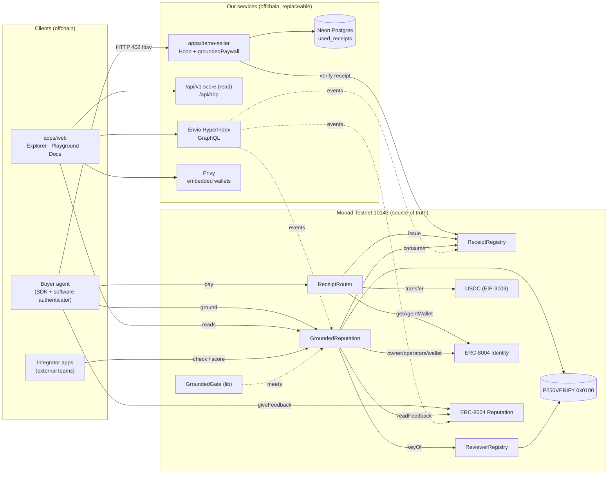
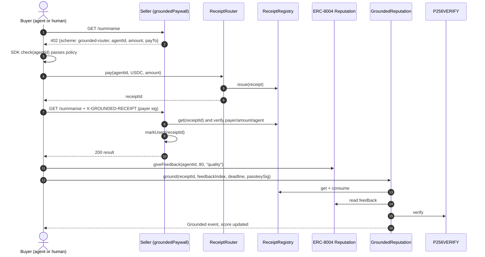

# Grounded — System Architecture

## 1. Principles

1. **Onchain decides, offchain assists.** Anything that affects a score lives in contracts on Monad. SDK, indexer, web, and demo services are replaceable conveniences.
2. **Don't fork ERC-8004.** Reviewers post feedback to the official Reputation Registry from their own address. Grounded links and filters.
3. **Non-custodial.** The router moves funds payer → agentWallet in one call and holds nothing.
4. **No privileged keys in the protocol.** Only keys we hold: a throwaway deployer (discarded) and a testnet drip wallet (no contract rights).

## 2. Component map



## 3. Trust boundaries

| Boundary | Trusted for | Not trusted for | If it's malicious/down |
|---|---|---|---|
| Contracts | Everything score-related | — | (No admin exists) |
| ERC-8004 registries | Identity, owner, wallet, feedback storage | Feedback truth | Grounded filters it |
| USDC token | Transfer correctness | — | Out of our control |
| SDK | Convenience | Anything | Any client can call contracts directly |
| Indexer | History, lists, raw counts | Scores | Explorer still reads `scoreOf` onchain |
| Seller paywall | Access control for its own API | Scores | Only affects that seller |
| Drip API | Handing out testnet funds | Anything else | Judges use public faucets |
| Privy | Wallet custody for demo users | Scores | Injected wallets still work |

## 4. Core flows

### 4.1 Pay → access → rate



### 4.2 Passkey binding
Browser `ox.WebAuthnP256.createCredential` → public key `(qx, qy)` → `sign(Bind challenge)` → `ReviewerRegistry.bind(qx, qy, sig)` → precompile verify → `ReviewerBound`.

### 4.3 Trust check (read only)
`g.check(id, policy)` → multicall `scoreOf(id)` + ERC-8004 `getSummary` (raw) → policy evaluation in SDK → `{pass, reasons}`. Onchain consumers call `meets()` directly.

### 4.4 Receipt lifecycle
`Issued` → (`ground`) → `Consumed` · `Issued` → (30 days) → expired (checked at read time, no tx).

## 5. Data model

### Onchain
| Contract | Storage |
|---|---|
| ReceiptRegistry | `receipts[id] → Receipt`, `nextId` |
| ReceiptRouter | `allowed[token]`, `decimals[token]` (constructor-set) |
| ReviewerRegistry | `keys[reviewer] → (qx,qy)`, `reviewerOf[keyHash]`, `nonces[reviewer]` |
| GroundedReputation | `histogram[agentId] → uint64[21]`, `live[agentId][reviewer] → (bucket, weight)`, `score[agentId] → Score`, `disputes[agentId]`, `lastOwner[agentId]` |

### Offchain (Envio, Postgres behind it)
`Agent`, `Receipt`, `Reviewer`, `Feedback`, `GroundedRating` — see TRD §7.
`used_receipts` in Neon for the demo seller.

## 6. Repository layout

```
grounded/
├─ contracts/                     # Foundry
│  ├─ src/
│  │  ├─ ReceiptRouter.sol
│  │  ├─ ReceiptRegistry.sol
│  │  ├─ ReviewerRegistry.sol
│  │  ├─ GroundedReputation.sol
│  │  ├─ GroundedGate.sol
│  │  ├─ adapters/Erc8004Adapter.sol
│  │  ├─ lib/{ScoringLib,GroundedWebAuthn}.sol
│  │  ├─ interfaces/  types/
│  ├─ test/{unit,fuzz,invariant,fork}/
│  ├─ script/{Deploy,DeployErc8004,Seed}.s.sol
│  └─ foundry.toml
├─ packages/
│  └─ sdk/                        # @grounded/sdk
│     └─ src/{client,score,check,pay,rate,fetch,gas,errors,addresses}.ts
│        src/passkey/{browser,software}.ts
│        src/server/paywall.ts
│        src/abi/ (generated by wagmi cli)
├─ apps/
│  ├─ web/                        # Next.js: explorer, playground, docs, api
│  ├─ demo-seller/                # Hono service
│  └─ demo-buyer/                 # TS agent script (optional AI SDK wrapper)
├─ indexer/                       # Envio HyperIndex config + handlers
├─ scripts/seed/                  # Sybil vs grounded demo data
├─ deployments/10143.json         # addresses + block numbers + erc8004Source
├─ docs/{planning,gas.md,BUILDLOG.md,OUTREACH.md}
├─ .github/workflows/ci.yml       # forge test, typecheck, lint, gitleaks
├─ .env.example
├─ pnpm-workspace.yaml
└─ README.md
```

## 7. Key architectural decisions

| ADR | Decision | Alternatives rejected | Why |
|---|---|---|---|
| 1 | Receipts via our router (option B) | Hosted facilitator (can't issue receipts), offchain proof (trusted party) | Only way a contract can know a payment happened |
| 2 | Onchain histogram score | Offchain aggregation + commitment | Composability: contracts can call `meets()` |
| 3 | Weighted median, no trim | Trimmed median (no-op), trimmed mean (more gas, more manipulable) | Robust, cheap, 21-slot walk |
| 4 | Passkeys via OZ WebAuthn + precompile | Hand-rolled P256 in Solidity | Audited parsing; precompile is 6,900 gas |
| 5 | Custom 402 scheme | Stock x402 exact | Stock scheme bypasses router |
| 6 | Envio hosted indexer | Ponder/self-hosted poller | Monad log range limits; free hosting; fallback exists |
| 7 | Monorepo, pnpm workspaces | Separate repos | One public repo for judges, shared ABIs |
| 8 | Immutable config, no admin | Ownable + setters | Removes admin-key risk; version by redeploy |

## 8. Failure modes

| Failure | User-visible effect | Handling |
|---|---|---|
| RPC slow/down | Reads fail | SDK accepts `rpcUrl`; web uses primary + fallback transport |
| Indexer lagging | Lists stale | Pages show "indexed up to block N"; scores still live |
| `ground` reverts | Rating not counted | SDK decodes custom error → readable message |
| Passkey unsupported on device | Can't rate | Show device guidance; software authenticator for agents only |
| Drip wallet empty | Judge can't fund | Link to public faucets; balance alert |
| ERC-8004 redeployed upstream | Adapter mismatch | Adapter isolated in one file; addresses in `deployments/` |
