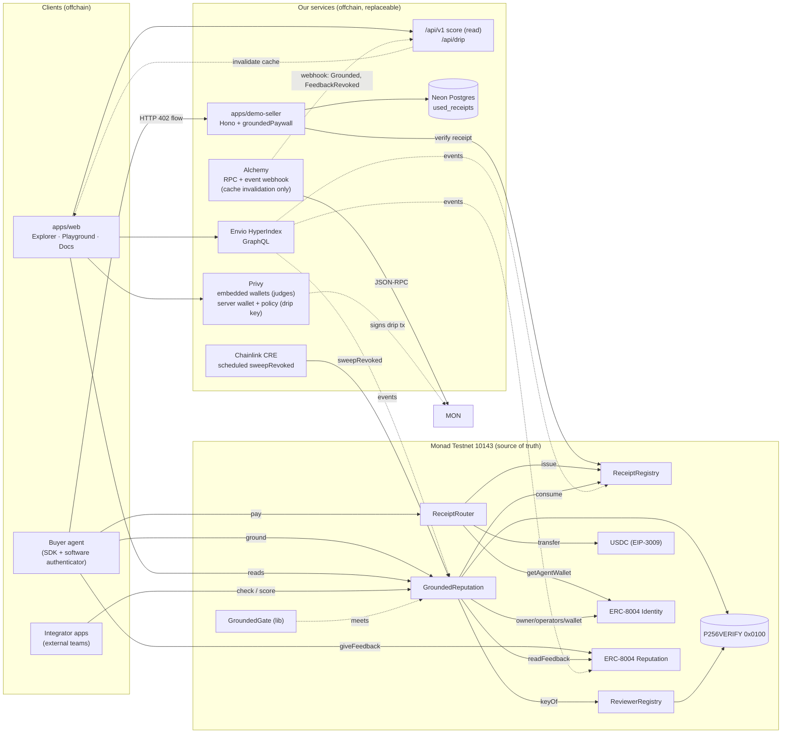
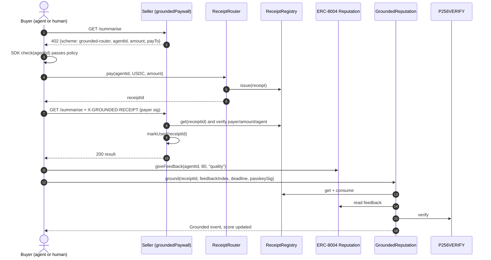

# Grounded — System Architecture

## 0. Verified environment facts (18 Sep, re-checked against testnet)

Every assumption below was probed on chain 10143, not read from a doc. Re-run the fork test (`forge test -n monad`, needs `MONAD_FORK_RPC`) before the 21 Sep deploy; it covers USDC EIP-3009 and the live agent. The P256 precompile and ERC-8004 selector probes were run by hand (no script checked in yet).

| Fact | Verified value | Consequence |
|---|---|---|
| P256 precompile | `0x0100` returns `1` for a valid vector (EIP-7951). No bytecode at the address — it is a real precompile, so `cast code` reads `0x`. | Passkey path is viable. OZ `WebAuthn.verify` → `P256.verify` reaches it. Kill-switch risk drops to client-side. |
| ERC-8004 Identity | `0x8004A818…BD9e`, ERC-1967 proxy → impl `0x7274e874…9c02` | Live. No self-deploy needed. |
| ERC-8004 Reputation | `0x8004B663…8713`, ERC-1967 proxy → impl `0x16e0fa7f…dA34` | Live. Adapter reads `readFeedback`. |
| ERC-8004 mutability | Both are UUPS proxies with an `owner` | **Trust assumption we do not control** — see §3 |
| Feedback value type | `readFeedback → (int128 value, uint8 valueDecimals, string tag1, string tag2, bool isRevoked)` | Adapter requires `valueDecimals == 0`, `0 ≤ value ≤ 100` |
| Raw summary | `getSummary(agentId, address[] clients, tag1, tag2)` — client list is **required** | Raw score needs `getClients()` first; unbounded array (§8) |
| USDC | `0x534b2f3A21130d7a60830c2Df862319e593943A3`, Circle proxy (zeppelinos slot) → impl `0x21240161…42fb` | 6 decimals |
| USDC EIP-3009 | `transferWithAuthorization`, `receiveWithAuthorization`, `authorizationState`, `cancelAuthorization` all present | `payWithAuthorization` path is real |
| USDC EIP-712 domain | name `"USDC"`, version `"2"`; on-chain `DOMAIN_SEPARATOR` matches the recomputed one exactly | Hardcode + regression test, as the spec demanded |

## 1. Principles

1. **Onchain decides, offchain assists.** Anything that affects a score lives in contracts on Monad. SDK, indexer, web, and demo services are replaceable conveniences.
2. **Don't fork ERC-8004.** Reviewers post feedback to the official Reputation Registry from their own address. Grounded links and filters.
3. **Non-custodial.** The router moves funds payer → agentWallet in one call and holds nothing.
4. **No privileged keys in the protocol.** Only keys we hold: a throwaway deployer (discarded) and a testnet drip wallet (no contract rights).

## 2. Component map



Read this map with §3: everything in **Services** can be deleted and Grounded still produces the same score. Nothing in **Services** is on the path between a payment and a rating.

## 3. Trust boundaries

| Boundary | Trusted for | Not trusted for | If it's malicious/down |
|---|---|---|---|
| Contracts | Everything score-related | — | (No admin exists) |
| ERC-8004 registries | Identity, owner, wallet, feedback storage | Feedback truth | Grounded filters it |
| ERC-8004 **upgrade owner** | Nothing | Everything — a malicious upgrade could make `readFeedback` lie or `ownerOf` flip | Unfixable by us. State it in the threat model as an inherited assumption; `Erc8004Adapter.sol` is the single file that changes if they redeploy, and `deployments/10143.json` (written at deploy, not yet in the repo) will pin the impl addresses we verified against |
| USDC token | Transfer correctness | — | Out of our control |
| SDK | Convenience | Anything | Any client can call contracts directly |
| Indexer | History, lists, raw counts | Scores | Explorer still reads `scoreOf` onchain |
| Seller paywall | Access control for its own API | Scores | Only affects that seller |
| Drip API | Handing out testnet funds | Anything else | Judges use public faucets |
| Privy | Wallet custody for demo users | Scores | Injected wallets still work |

## 4. Core flows

### 4.1 Pay → access → rate



### 4.2 Passkey binding
Browser `ox.WebAuthnP256.createCredential` → public key `(qx, qy)` → `sign(Bind challenge)` → `ReviewerRegistry.bind(qx, qy, sig)` → precompile verify → `ReviewerBound`.

### 4.3 Trust check (read only)
`g.check(id, policy)` → multicall `scoreOf(id)` + ERC-8004 `getSummary` (raw) → policy evaluation in SDK → `{pass, reasons}`. Onchain consumers call `meets()` directly.

### 4.4 Receipt lifecycle
`Issued` → (`ground`) → `Consumed` · `Issued` → (30 days) → expired (checked at read time, no tx).

### 4.5 Revocation sweep (**gap found 18 Sep — was missing from v1**)

A reviewer can revoke their ERC-8004 feedback *after* it was grounded. Nothing in the original design removed that rating from the histogram, so a revoked rating kept counting forever. That is a correctness bug in a trust primitive, not a nice-to-have.

```
sweepRevoked(uint256 agentId, address reviewer)   // permissionless, no auth, no admin
  1. live = live[agentId][reviewer]; require exists           -> NothingToSweep()
  2. re-read the stored feedbackIndex via Erc8004Adapter
  3. if !isRevoked -> revert StillValid()   (no silent no-op; callers must not burn gas blindly)
  4. remove (bucket, weight) from histogram, delete live entry, reviewers--, emit Swept
```

Requires storing `feedbackIndex` in the `Live` struct (`uint64`) — a storage-layout change to `GroundedReputation`, so it must land **before** the 21 Sep deploy, not after.

Who calls it: anyone. The indexer watches `FeedbackRevoked` and lists sweepable pairs; the explorer shows "1 revoked rating pending sweep"; Chainlink CRE (doc 06 §9) schedules the sweep. **This is the only thing that makes CRE load-bearing** — without it CRE has nothing real to do and gets removed per 06 §2.

## 5. Data model

### Onchain
| Contract | Storage |
|---|---|
| ReceiptRegistry | `receipts[id] → Receipt`, `nextId` |
| ReceiptRouter | `allowed[token]`, `decimals[token]` (constructor-set) |
| ReviewerRegistry | `keys[reviewer] → (qx,qy)`, `reviewerOf[keyHash]`, `nonces[reviewer]` |
| GroundedReputation | `histogram[agentId] → uint64[21]`, `live[agentId][reviewer] → Live{uint8 bucket; uint8 weight; uint64 feedbackIndex; bool exists}` (one slot), `score[agentId] → Score`, `disputes[agentId]`, `lastOwner[agentId]` |

### Offchain (Envio, Postgres behind it)
`Agent`, `Receipt`, `Reviewer`, `Feedback`, `GroundedRating` — see TRD §7.
`used_receipts` in Neon for the demo seller.

## 6. Repository layout

```
grounded/
├─ contracts/                     # Foundry
│  ├─ src/
│  │  ├─ ReceiptRouter.sol
│  │  ├─ ReceiptRegistry.sol
│  │  ├─ ReviewerRegistry.sol
│  │  ├─ GroundedReputation.sol
│  │  ├─ GroundedGate.sol
│  │  ├─ adapters/Erc8004Adapter.sol
│  │  ├─ lib/{ScoringLib,GroundedWebAuthn}.sol
│  │  ├─ interfaces/  types/
│  ├─ test/{unit,fuzz,invariant,fork}/
│  ├─ script/{Deploy,DeployErc8004,Seed}.s.sol
│  └─ foundry.toml
├─ packages/
│  └─ sdk/                        # @grounded/sdk
│     └─ src/{client,score,check,pay,rate,fetch,gas,errors,addresses}.ts
│        src/passkey/{browser,software}.ts
│        src/server/paywall.ts
│        src/abi/ (generated by wagmi cli)
├─ apps/
│  ├─ web/                        # Next.js: explorer, playground, docs, api
│  ├─ demo-seller/                # Hono service
│  └─ demo-buyer/                 # TS agent script (optional AI SDK wrapper)
├─ indexer/                       # Envio HyperIndex config + handlers
├─ scripts/seed/                  # Sybil vs grounded demo data
├─ deployments/10143.json         # addresses + block numbers + erc8004Source
├─ docs/{planning,gas.md,BUILDLOG.md,OUTREACH.md}
├─ .github/workflows/ci.yml       # forge test, typecheck, lint, gitleaks
├─ .env.example
├─ pnpm-workspace.yaml
└─ README.md
```

## 7. Key architectural decisions

| ADR | Decision | Alternatives rejected | Why |
|---|---|---|---|
| 1 | Receipts via our router (option B) | Hosted facilitator (can't issue receipts), offchain proof (trusted party) | Only way a contract can know a payment happened |
| 2 | Onchain histogram score | Offchain aggregation + commitment | Composability: contracts can call `meets()` |
| 3 | Weighted median, no trim | Trimmed median (no-op), trimmed mean (more gas, more manipulable) | Robust, cheap, 21-slot walk |
| 4 | Passkeys via OZ WebAuthn + precompile | Hand-rolled P256 in Solidity | Audited parsing; precompile is 6,900 gas |
| 5 | Custom 402 scheme | Stock x402 exact | Stock scheme bypasses router |
| 6 | Envio hosted indexer | Ponder/self-hosted poller | Monad log range limits; free hosting; fallback exists |
| 7 | Monorepo, pnpm workspaces | Separate repos | One public repo for judges, shared ABIs |
| 8 | Immutable config, no admin | Ownable + setters | Removes admin-key risk; version by redeploy |
| 9 | Revocation handled by a **permissionless sweep**, not by reading revocation status inside `scoreOf` | (a) check `isRevoked` for every reviewer on read — unbounded external calls in a view every consumer pays for; (b) trusted keeper | Keeps `scoreOf`/`meets` O(21) and callable from another contract. Cost: a revoked rating counts until someone sweeps — bounded, visible in the explorer, and cheap to fix by anyone |
| 10 | Deploy addresses **precomputed** (`vm.computeCreateAddress`), constructor args immutable | Post-deploy `setX()` wiring | The registry↔router↔reputation triangle is circular; setters would reintroduce an admin key and break ADR 8 |
| 11 | Integration boundary is explicit: Alchemy = node + push, Envio = queryable history, Privy = custody of *our* hot keys only | Alchemy webhooks driving score recompute (doc 06 §6) | There is no off-chain score to recompute — `scoreOf` computes on read. Webhooks can only invalidate explorer cache. Claiming otherwise in a README a judge reads is worse than not integrating |

## 8. Failure modes

| Failure | User-visible effect | Handling |
|---|---|---|
| RPC slow/down | Reads fail | SDK accepts `rpcUrl`; web uses primary + fallback transport |
| Indexer lagging | Lists stale | Pages show "indexed up to block N"; scores still live |
| `ground` reverts | Rating not counted | SDK decodes custom error → readable message |
| Passkey unsupported on device | Can't rate | Show device guidance; software authenticator for agents only |
| Drip wallet empty | Judge can't fund | Link to public faucets; balance alert |
| ERC-8004 redeployed upstream | Adapter mismatch | Adapter isolated in one file; addresses in `deployments/` |
| **Agent with many clients** — `getClients()` returns an unbounded array and `getSummary` needs it | Raw-score read times out or blows the RPC response limit; explorer page half-loads | Raw score is **advisory UI only**, never used by `check()`/`meets()`. SDK caps the client list (first N + count from the indexer) and returns `rawScore: null` past the cap. Never block a trust decision on a read that can be griefed by registering clients |
| **Revoked feedback not yet swept** (§4.5) | Score slightly stale in the agent's favour | Explorer shows pending-sweep count; anyone can sweep; CRE schedules it |
| **Wash rating** (T2) | Owner rates themselves from a funded EOA; the USDC returns to their own `agentWallet`, so the real cost is gas plus the float | Not solved, and we say so first. Structural dampers: weight cap 4 (≥0.70 USDC buys no more influence), one live rating per reviewer, owner/operator/wallet exclusion, and the explorer showing distinct payers next to total paid so a 40-rating agent with 2 payers reads as what it is |
| Privy / Alchemy / Envio outage | Judge login, push updates, or history lists fail | Each is offchain and replaceable: injected wallet, public RPC, direct `scoreOf` reads. No score depends on them |
