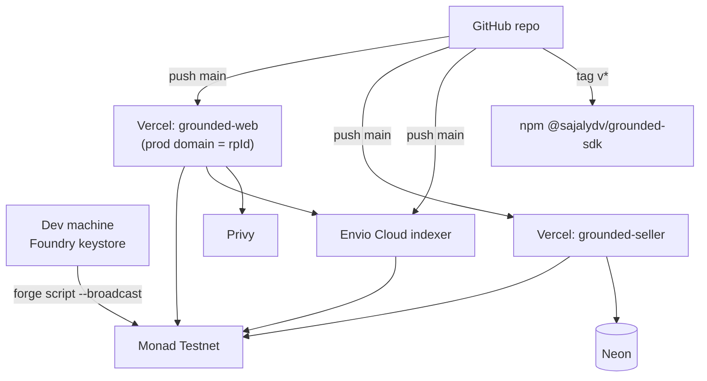

# Grounded — Deployment, Components & Requirements

## 1. Short answer

- **No servers, VPS, or hardware to buy.** Everything runs on testnet + free tiers.
- **Expected spend: ₹0.** Optional: a custom domain (~₹800–1,200/yr) if you don't want a `*.vercel.app` rpId. Using a subdomain of a domain you already own costs nothing.
- **No self-hosting required.** Railway/Render is only a fallback if Envio or Vercel don't fit.
- Confirm free-tier limits when you sign up; they change. Nothing here needs a paid plan at hackathon traffic.

## 2. Where each component runs

| Component | Runs on | Plan | Why here |
|---|---|---|---|
| 4 contracts + GroundedGate | **Monad Testnet (10143)** | Gas in faucet MON | Required by track |
| ERC-8004 registries | Monad Testnet (canonical, or self-deployed if A1 fails) | — | Standard we build on |
| `apps/web` (explorer, playground, docs, API routes) | **Vercel** | Hobby (free) | Next.js native; stable HTTPS domain for passkeys |
| `apps/demo-seller` | **Vercel** (separate project, Hono on Node runtime) | Hobby (free) | No always-on process needed |
| `apps/demo-buyer` | Local / GitHub Action (manual trigger) | Free | Only used in demo + seeding |
| Indexer | **Envio Cloud** (HyperIndex) | Free dev tier | First-class Monad testnet support; avoids log-range limits |
| Postgres (`used_receipts`) | **Neon** | Free | Already in your stack |
| Embedded wallets | **Privy** | Free dev tier | Email login for judges |
| SDK package | **npm** | Free (public) | Integrators install it |
| Source | **GitHub** (public) | Free | Required deliverable |
| Videos | YouTube (unlisted) or Loom | Free | Required deliverable |
| RPC | Monad public RPC + one provider key (Alchemy/QuickNode free) as fallback | Free | Redundancy for demo day |

Fallbacks: indexer down → viem poller (10-block ranges) on **Railway** (Hobby, low single-digit USD) writing to Neon. Vercel issue → **Render** free web service.

## 3. Deployment topology



## 4. Accounts to create (day 1–2)

- [ ] GitHub repo (public from 22 Sep) + invite `metropolis@hackathon.monad.xyz`
- [ ] Vercel (2 projects), custom domain attached to `grounded-web` **before** any passkey testing
- [ ] Envio Cloud (GitHub login)
- [ ] Neon project `grounded`
- [ ] Privy app (allowed origin = production domain + localhost)
- [ ] npm org/scope (check `@grounded` availability; fallback to your own scope)
- [ ] Alchemy or QuickNode (Monad testnet endpoint)
- [ ] Monad testnet faucet + Circle faucet (USDC, Monad Testnet)
- [ ] Block explorer API key for contract verification (whichever explorer Monad docs list for testnet verification)
- [ ] YouTube/Loom

## 5. Local requirements

| Tool | Version | Purpose |
|---|---|---|
| Node.js | 20 LTS+ | SDK, web, services |
| pnpm | 9+ | Workspaces |
| Foundry | latest `foundryup` | Contracts, tests, deploy |
| Git | any recent | — |
| Docker Desktop | latest | Envio local dev only |
| Slither (`pipx install slither-analyzer`) + Aderyn | latest | Static analysis |
| gitleaks | latest | Secret scanning |
| A passkey-capable device | Win Hello / Touch ID / phone | Real WebAuthn tests |

Windows note: run Foundry and Envio inside WSL2; keep the repo in the WSL filesystem, not `/mnt/c`, for speed and to avoid path issues.

## 6. Dependencies (pin exact versions in lockfile)

Contracts: `openzeppelin-contracts` (tag with precompile-direct WebAuthn path), `forge-std`.
SDK: `viem`, `ox`, `zod`, `tsup`, `vitest`, `@wagmi/cli`.
Web: `next`, `react`, `tailwindcss`, `shadcn/ui`, `fumadocs`, `@privy-io/react-auth`, `@tanstack/react-query`, `mermaid` (docs), `@upstash/ratelimit` or in-route limiter.
Seller: `hono`, `@neondatabase/serverless`.
Indexer: `envio`.
CI: GitHub Actions — `foundry-rs/foundry-toolchain`, `pnpm/action-setup`, `gitleaks/gitleaks-action`.

## 7. Environment variables (`.env.example`)

```bash
# ---------- shared ----------
NEXT_PUBLIC_CHAIN_ID=10143
NEXT_PUBLIC_RPC_URL=https://testnet-rpc.monad.xyz      # public RPC
RPC_URL_FALLBACK=                                       # Alchemy/QuickNode Monad testnet URL (secret)
NEXT_PUBLIC_RP_ID=                                      # production domain, MUST equal contract RP_ID

# ---------- contracts (deploy only; key lives in Foundry keystore, not here) ----------
DEPLOYER_ACCOUNT=grounded-deployer                      # cast wallet name
USDC_ADDRESS=                                           # Monad testnet USDC
ERC8004_IDENTITY=0x8004A818BFB912233c491871b3d84c89A494BD9e
ERC8004_REPUTATION=0x8004B663056A597Dffe9eCcC1965A193B7388713
VERIFIER_API_KEY=                                       # explorer verification key (secret)

# ---------- web ----------
NEXT_PUBLIC_PRIVY_APP_ID=
PRIVY_APP_SECRET=                                       # secret, server only
NEXT_PUBLIC_INDEXER_URL=                                # Envio GraphQL endpoint
DRIP_PRIVATE_KEY=                                       # secret; testnet-only wallet, no contract roles
DRIP_MON_AMOUNT=0.2                                     # per user per 24h
DRIP_USDC_AMOUNT=1                                      # per user per 24h

# ---------- demo seller ----------
SELLER_AGENT_ID=
SELLER_PRICE_USDC=0.05
DATABASE_URL=                                           # Neon, secret

# ---------- demo buyer (local only) ----------
BUYER_PRIVATE_KEY=                                      # secret, testnet only, never committed
BUYER_PASSKEY_SEED=                                     # software authenticator key, testnet only
```

Contract addresses are **not** env vars: they are read from `deployments/10143.json` and baked into the SDK.

## 8. Deploy runbook

```bash
# 1. Contracts
cd contracts
forge build && forge test
forge script script/Deploy.s.sol \
  --rpc-url $NEXT_PUBLIC_RPC_URL --account grounded-deployer \
  --broadcast --verify
# writes deployments/10143.json; commit it

# 2. SDK
pnpm --filter @sajalydv/grounded-sdk generate   # wagmi cli -> abi/
pnpm --filter @sajalydv/grounded-sdk build && pnpm --filter @sajalydv/grounded-sdk test
pnpm --filter @sajalydv/grounded-sdk publish --access public --tag beta

# 3. Indexer
cd indexer && pnpm envio codegen && git push   # Envio Cloud deploys from repo

# 4. Web + seller
# Vercel: import repo twice, root dirs apps/web and apps/demo-seller, add env vars, attach domain

# 5. Seed demo data
pnpm --filter seed run all

# 6. Smoke test on production URLs (no local processes)
pnpm --filter demo-buyer start -- --target https://<seller-domain>/summarise
```

"Live" means: custom domain resolves over HTTPS, passkey bind works on that domain, playground completes from a phone.

## 9. Secrets policy

- Deployer: Foundry keystore, fresh key, emptied and abandoned after deploy.
- Drip + buyer keys: testnet only, Vercel encrypted env / local `.env` (gitignored).
- Rotate before repo goes public (22 Sep): old AgenPay facilitator `PRIVATE_KEY`, Neon password, any key ever committed.
- `gitleaks detect --log-opts="--all"` on full history; if anything is found, rotate **and** rewrite history (`git filter-repo`) before making public.
- README section "Keys we hold and why" listing exactly the drip wallet and its limits.

## 10. Judge access (publish in README + submission form)

1. Open `https://<domain>/playground`.
2. Log in with email (Privy) → click **Get test funds**.
3. Create passkey → pay the demo agent 0.05 USDC → rate it.
4. Open `/agents/<id>` and see raw vs grounded.
5. Contract addresses + explorer links: `/docs/contracts`.
Fallback: public faucet links + injected wallet instructions.
